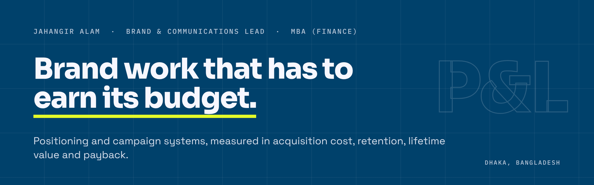

**Brand & Communications Lead** · MBA (Finance) · Dhaka, Bangladesh

Brand budgets rarely leak in the strategy deck. They leak at the handoffs: finance to brand, brand to production, production to the market. The work here closes those gaps with positioning and campaign systems, led and produced in-house, then measured in the numbers finance already uses.

---

### Golden Assets: free tools for businesses without a data team

| Tool | What it decides | Built |
|---|---|---|
| **[Growth Tracker](https://github.com/jahangirartist/golden-assets-growth-tracker)** | What to fix, fund or cut next: unit economics, channel verdicts and a growth readiness gate on one dashboard | 18 tabs · 4,607 formulas |
| **[30-Day ICE Content Calendar](https://github.com/jahangirartist/golden-assets-ice-content-calendar)** | Which content ideas earn production time, and whether the plan fits the hours you have | 9 tabs · 461 formulas |

Both are built for Google Sheets, macro-free and released under CC BY 4.0, with a Bangla quick-start for Bangladeshi business owners.

---

### How the work runs

1. **Define the job.** What the brand is actually being hired to do, in the customer's terms.
2. **Write the narrative.** Positioning and messaging that make a customer feel it.
3. **Measure the move.** Acquisition cost, retention, lifetime value and payback, read every month.

### Background

- Brand and communications for a 31-year, ISO 9001:2015-certified security group operating across all 64 districts of Bangladesh.
- Co-Founder of 3 Seconds Studio: positioning, identity and campaign work for small businesses since 2021.
- Five years of business-risk analysis for US clients before moving into brand.

### Credentials

MBA (Finance), University of Rajshahi · Brand Management, University of London (94%) · IBM Enterprise Design Thinking Practitioner · Google Prompting Essentials

**Contact:** jahangirartist.x@gmail.com
